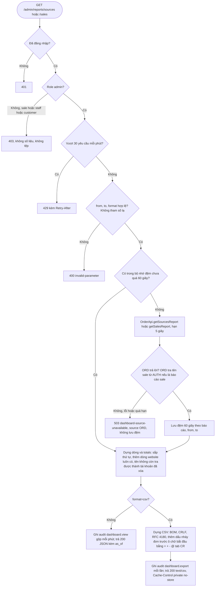
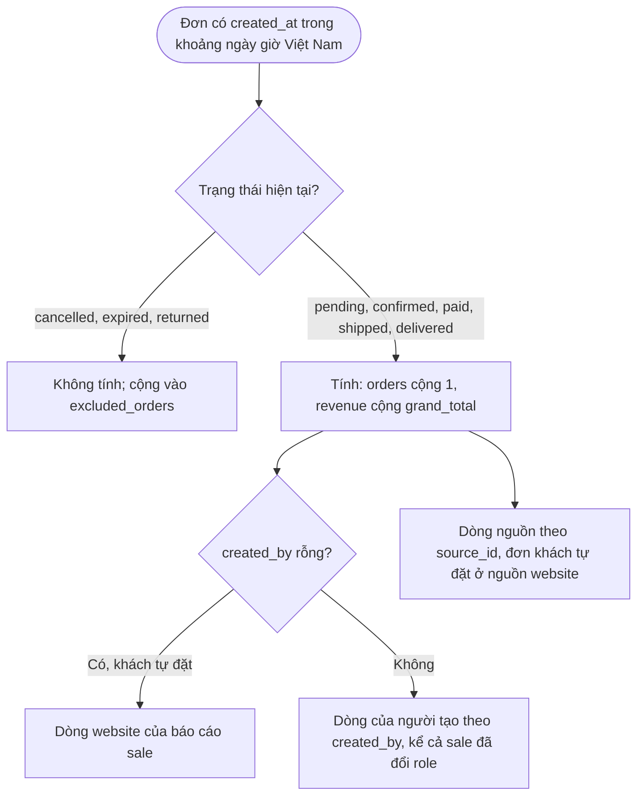

# Flow: Báo cáo theo nguồn đơn và theo sale, xem hoặc xuất CSV (DSH)

Bổ sung cho flow chung của DSH (DSH-FLOW-20261006-105126642): hai báo cáo mới đi qua cùng các cổng kiểm quyền, giới hạn tần suất, tham số và bộ nhớ đệm; sơ đồ dưới chỉ vẽ phần khác (lấy dữ liệu từ ORD, loại đơn, CSV).

## 1. Một yêu cầu báo cáo theo nguồn hoặc theo sale

## 2. Đơn nào được tính vào số tính lương

## Chú thích
- Nhánh 401, 403, 429, 400, 503 có Given/When/Then ở DSH-REQ-20261015-092608812 (theo nguồn), DSH-REQ-20261015-092608849 (theo sale) và DSH-REQ-20261006-105126549 (quy tắc chung).
- Epic khác bị chạm tới: ORD (`OrderApi.getSourcesReport`, `OrderApi.getSalesReport`; ORD tra tên từ AUTH), SAL (đặt `source_id`, `created_by` khi tạo đơn hộ), PRJ (AuditLog, giới hạn tần suất, `registerProblem`).
