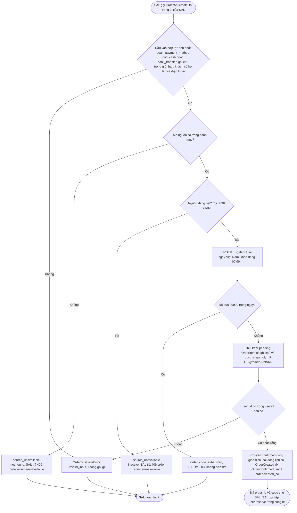
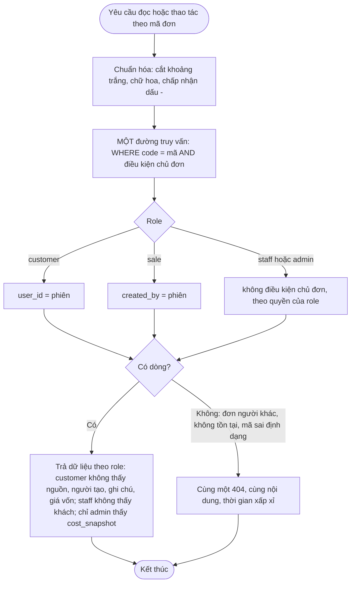
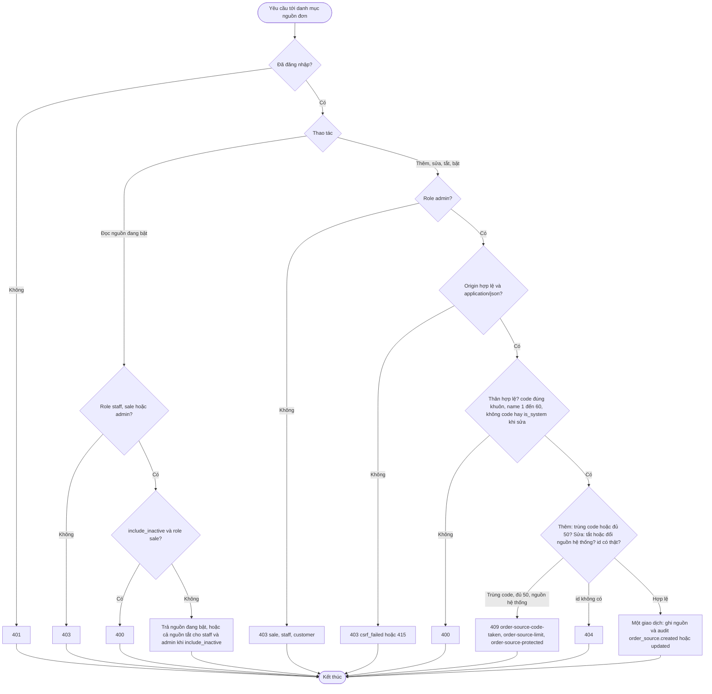
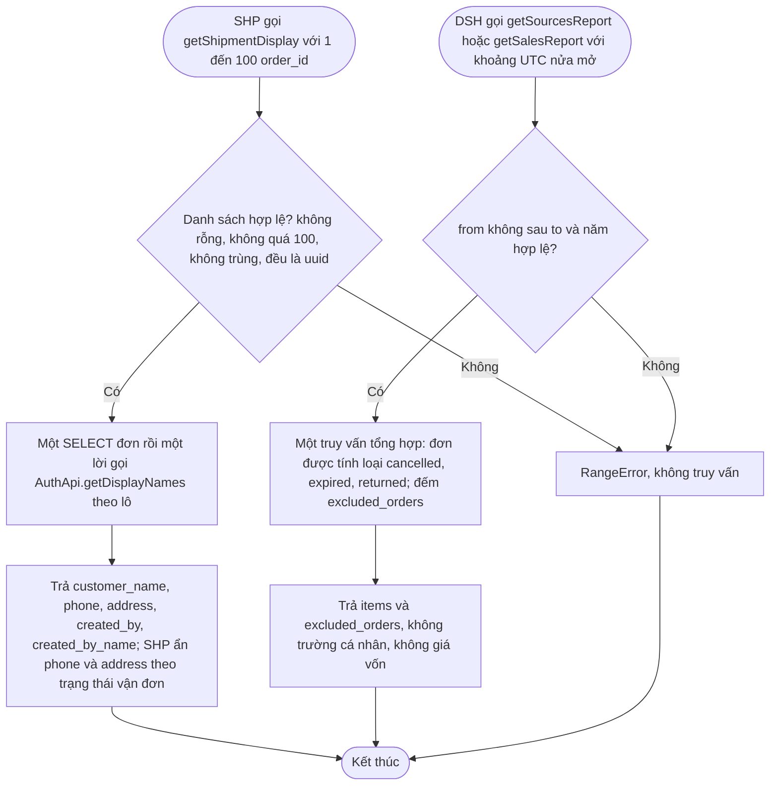

# Flow: Mã đơn, đơn hộ, nguồn đơn và đọc theo mã có kiểm chủ đơn (ORD, đợt bán hộ 2026-10-15)

Bổ sung cho `ORD-FLOW-20261006-092320857` (truy cập, hủy, vòng đời): phần dưới là đường tạo đơn hộ và cấp mã, đường quản trị nguồn đơn, và quy tắc kiểm chủ đơn khi đọc theo mã (mã tuần tự, ADR-024).

## 1. Tạo đơn hộ và cấp mã (SAL gọi ORD trong giao dịch của SAL)

## 2. Đọc theo mã đơn: kiểm chủ đơn (mã đoán được)

## 3. Quản trị nguồn đơn (admin) và đọc danh mục

## 4. Giao diện đọc cho SHP và DSH

## Chú thích
- Mỗi nhánh lỗi có Given/When/Then ở requirement tương ứng: nhánh 1 ở ORD-REQ-20261015-092748715; nhánh 2 ở ORD-REQ-20261015-092748640; nhánh 3 ở ORD-REQ-20261015-092748678; nhánh 4 ở ORD-REQ-20261015-092748751.
- Epic khác bị chạm: SAL (gọi `createHo`, `listSources`; ánh xạ lỗi sang HTTP), INV (giữ hàng trong cùng giao dịch của SAL, chốt khi nhận OrderConfirmed), PAY (OrderCreated của `cash`, `bank_transfer`), SHP (`getShipmentDisplay`, `findForShipment` có `created_by`), DSH (báo cáo), NTF và REV (bỏ qua đơn không `user_id`), AUTH (guard role `sale`, `getDisplayNames`).
