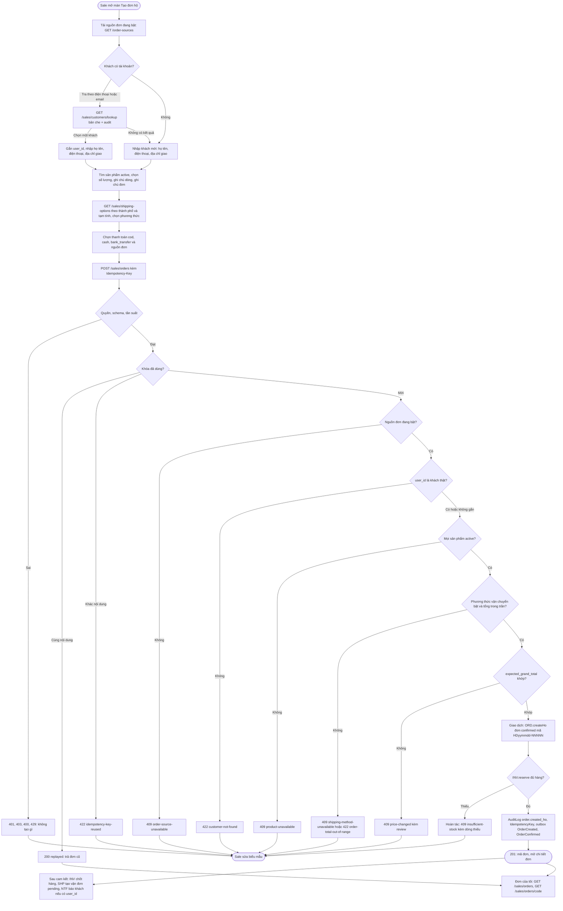

# Flow: sale tạo đơn hộ và theo dõi đơn của tôi

## Chú thích
- Mỗi nhánh lỗi có Given/When/Then trong SAL-REQ-20261015-092710847 (quyền, schema, khóa idempotency, `price-changed`) và SAL-REQ-20261015-092711128 (nguồn, sản phẩm, hết hàng); thứ tự kiểm ở BR5 của SAL-REQ-20261015-092711128.
- Epic khác bị chạm: ORD (`createHo`, nguồn đơn, mã HD, OrderCreated, OrderConfirmed), INV (`reserve`, chốt hàng bằng OrderConfirmed), SHP (phí, vận đơn `pending`), PRD (giá bán, `cost_price` chỉ đi vào đơn), USR (tra khách, kiểm `user_id`), NTF (chỉ báo khi `user_id` có), PAY (ghi thu `cash`, `bank_transfer`), REV, DSH.
